<h1 align="center">
   
  
   
  es_extended — X3D build
   
</h1>

  <b>🇬🇧 English</b> •
  <a href="docs/i18n/README.th.md">🇹🇭 ไทย</a>

<h4 align="center">ESX Legacy core (esx_core 1.13.4) hardened for live servers: players stop losing characters, saves are faster, and the economy is harder to duplicate. Drop-in replacement — the resource is still called <code>es_extended</code>.</h4>

  
  
  
  

  <a href="https://fivem.x3d-developer.com/en/products/es-extended/">🌐 Website</a> •
  <a href="https://fivem.x3d-developer.com/en/docs/es-extended/">📖 Docs</a> •
  <a href="https://discord.gg/NA5kPVynFv">💬 Discord</a> •
  <a href="https://fivem.x3d-developer.com/en/products/">🛒 More FiveM scripts (free + premium)</a>

---

> **This is a fork, not an official ESX release.** It is based on [esx_core](https://github.com/esx-framework/esx_core) 1.13.4 and does not automatically track new ESX releases. Original copyright belongs to Jérémie N'gadi and the ESX Legacy project. Distributed under the GNU GPL v3, same as upstream.

## ✨ Why replace the core

**Players stop losing their characters**
- No more waking up at map origin or dead: position `(0,0,0)` and health `0` read from a culled ped are never saved over the real row
- `Config.SaveInterval` saves everyone on a timer, so a crash no longer rolls the whole session back
- Spawning waits for collision to load (with a timeout), so players don't fall through the map
- The item catalog retries until the database is up, instead of staying empty for a whole session

**Faster**
- Accounts, inventory and loadout lookups are O(1) instead of a full scan per call
- Saving a player re-encodes only what changed
- Unanswered `ESX.TriggerServerCallback` requests time out and are cleaned up instead of staying in memory
- Squared distances instead of `sqrt`, range-based sleeps, batched `GlobalState` writes

**Harder to exploit**
- Economy lock for the last minutes before a txAdmin restart (the classic duplication window)
- One audit log for money, items, weapons, joins, leaves, chat and deaths, with per-kind Discord webhooks and alert thresholds
- Client ammo values are clamped
- Banned-word filter with strikes and an automatic kick

## 📦 Install
1. Stop the server
2. Move your existing `es_extended` outside `resources/`
3. Put this folder in its place (keep the name `es_extended`)
4. Start the server — no SQL to run if you already have an ESX database (fresh install: `es_extended.sql`)

Table names are in `shared/config/main.lua` → `Config.Tables` (defaults: stock ESX names). `nc_inventory` and `ox_inventory` are detected for notification icons.

Full configuration (restart lock, audit-log convars, the ENTER WORLD handshake for loading screens, added events and commands): **[docs on our website](https://fivem.x3d-developer.com/en/docs/es-extended/)**.

## 🔧 Changes from esx_core 1.13.4 (GPL-3.0 §5a)
Modified 2026-09 by X3D Developer. The file-by-file list of changes is in **[docs/i18n/README.th.md](docs/i18n/README.th.md)** (Thai). In short: player save guards and periodic saves, O(1) xPlayer indexes and dirty-tracking saves, callback timeouts and cleanup, OneSync/points distance work, batched `GlobalState`, restart lock, server audit log, ammo clamp, chat filter, spawn collision wait, item catalog retry, and the boot banner.

## 💬 Support & updates
Support and new versions are on **[Discord](https://discord.gg/NA5kPVynFv)** and the **[website](https://fivem.x3d-developer.com/en/products/es-extended/)** — not GitHub issues. More free and premium FiveM scripts: **[fivem.x3d-developer.com](https://fivem.x3d-developer.com)**.

## 📄 License
GNU General Public License v3.0 — see [LICENSE](LICENSE). You may use, modify and redistribute it under the same licence.
